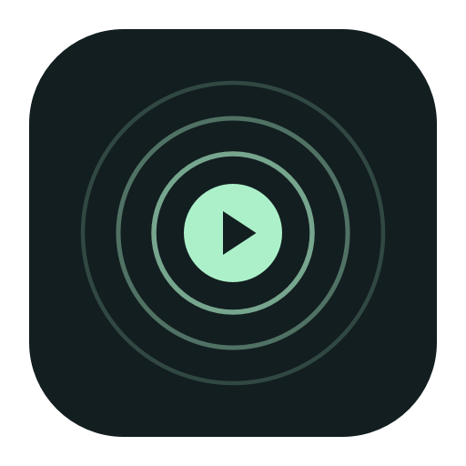
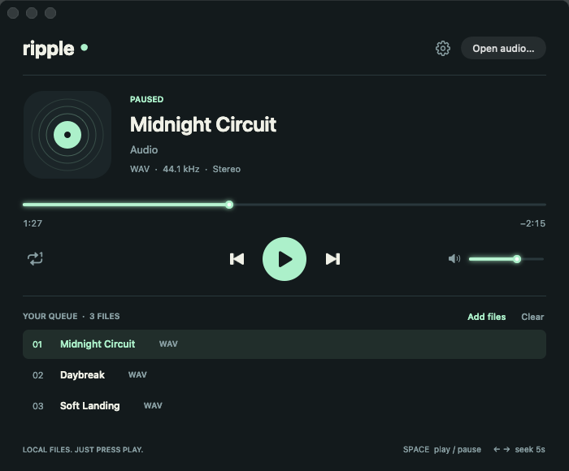
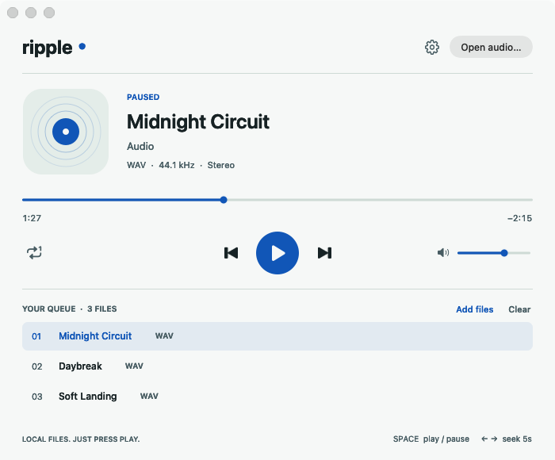
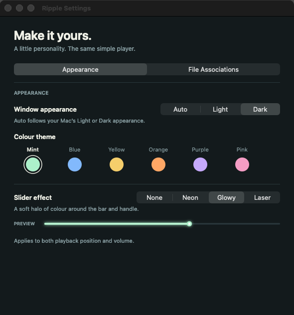

<p align="center">
  
</p>

<h1 align="center">Ripple</h1>

<p align="center">A little player for your local audio.</p>

<p align="center">
  <a href="https://github.com/othnielvtf/ripple/releases/latest">Download for macOS</a> ·
  <a href="#build-from-source">Build from source</a> ·
  <a href="https://github.com/othnielvtf/ripple/issues">Report an issue</a>
</p>

<p align="center">
  
  
  <a href="LICENSE"></a>
</p>



Drop in an audio file and press play. Ripple is a small, native Mac app built with **Swift, AppKit, and AVFoundation**. It keeps local listening simple, with a queue, keyboard controls, and a little personality.

## Features

- **Local audio:** MP3, WAV, M4A, AAC, AIFF, and CAF. Open multiple files, drag them onto the window, or use Finder’s Open With menu.
- **Simple playback:** play/pause, seek, volume, previous/next, repeat one, and automatic queue advance.
- **Make it yours:** Mint, Blue, Yellow, Orange, Purple, and Pink themes, with Light, Dark, or Auto appearance.
- **Light effects:** None, Neon, Glowy, and Laser styles for both progress and volume, with a draggable live preview.
- **Finder integration:** set Ripple as the default player for individual formats or all supported formats from Settings.
- **A small native app:** universal Apple Silicon + Intel binary, approximately 1 MB unpacked, with no third-party dependencies or network code.

Appearance, effects, volume, and repeat preferences are remembered. Your queue is temporary; audio files stay where you put them.

## Screenshots

| Light appearance | Appearance settings |
| --- | --- |
|  |  |

Screenshots show the actual AppKit interface with generated demo audio.

## Download and install

1. Download the universal macOS ZIP from the [latest release](https://github.com/othnielvtf/ripple/releases/latest).
2. Unzip it and move **Ripple.app** to **Applications**.
3. Open Ripple and press **⌘O**, or drop audio files onto the window.

Requires **macOS 13 Ventura or later**. The same download supports Apple Silicon and Intel Macs. Release assets include a `SHA256SUMS` file for checking the download.

**Signing:** the current release is ad hoc signed, without a Developer ID certificate or Apple notarization. macOS may block the first launch. After attempting to open it, you can approve the app in **System Settings → Privacy & Security → Open Anyway**, if you trust the download. See [Apple’s instructions](https://support.apple.com/en-us/102445), or build it locally using the steps below.

## Settings

Click the gear beside **Open audio**, or press **⌘,**.

**Appearance** controls the colour theme, Light/Dark/Auto mode, and the shared slider effect. Changes apply immediately without resetting the track or queue. Effects redraw with the sliders and do not run an animation timer.

**File Associations** shows the current default app for each audio format. Choose **Make Default** or **Make Default for All**, and respond to any macOS consent prompts. Move Ripple to its permanent location before assigning defaults.

## Keyboard shortcuts

| Shortcut | Action |
| --- | --- |
| Space | Play / pause |
| ← / → | Seek backward / forward 5 seconds |
| ⌘← / ⌘→ | Previous / next track |
| ⌘O | Open audio and replace the queue |
| ⇧⌘O | Add files to the queue |
| ⌘L | Toggle repeat current track |
| ⌘R | Reveal current file in Finder |
| ⌘Delete | Clear the queue |
| ⌘, | Open Settings |
| ⌘Q | Quit |

Previous restarts the current track after three seconds. Closing the player window quits the app and stops audio.

## Build from source

Install Xcode or Apple’s Command Line Tools, then:

```sh
git clone https://github.com/othnielvtf/ripple.git
cd ripple
./Scripts/build.sh
open dist/Ripple.app
```

The script compiles optimized `arm64` and `x86_64` executables, combines them into a universal app, generates the icon, and applies a local ad hoc signature. It downloads no dependencies.

To choose another output directory:

```sh
./Scripts/build.sh /path/to/output
```

You can also open `Package.swift` in Xcode to browse and run the executable. Build the `.app` bundle to use Finder integration and default-app settings.

## Tests

```sh
./Scripts/test.sh
# Also exercise an actual MP3 file:
./Scripts/test.sh /path/to/example.mp3
```

The suite generates temporary WAV files and plays them silently through an audio output. It checks decoding, seeking, queue transitions, corrupt-file recovery, preferences, theme contrast, file-association handling, and custom slider rendering. The slider checks render **288 combinations** of effects, colours, appearance, length, and position. Default-app mutations use a test workspace; real system associations are only read.

**87 checks passed locally with an MP3 fixture on Apple Silicon and macOS 26.6.2.** The default run has 85 checks; providing an MP3 adds two. The Intel binary is cross-compiled and has not been tested on Intel hardware. GitHub Actions builds and verifies the universal bundle.

## Contributing

Issues and pull requests are welcome. See [CONTRIBUTING.md](CONTRIBUTING.md) for the project layout and validation steps. To prepare a release archive locally, run:

```sh
./Scripts/package-release.sh 1.2.0
```

Published GitHub releases trigger a workflow that builds the app and attaches the universal ZIP and checksums.

## License

[MIT](LICENSE) © 2026 Othniel naga.
